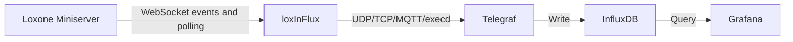

# loxInFlux

[](https://opensource.org/licenses/MIT)


[](https://hub.docker.com/r/acidcliff/loxinflux)

> ⚠️ This project is in no way affiliated with Loxone, software, company or its developers.

loxInFlux collects metrics from your Loxone Miniserver and forwards them to
Telegraf as Influx line protocol, so you can store and visualize your smart home
data in InfluxDB or any other output Telegraf supports.

Since **0.5.0** loxInFlux is a single Rust binary (no Python runtime). It uses
[loxwebsocket](https://github.com/Jakob-Gliwa/loxwebsocketclient-rs) **0.3.2**
for the Miniserver connection and writes over UDP, TCP, MQTT 3.1.1 (QoS 0) or
execd/stdout. The last Python release is
[0.3.0](https://github.com/Jakob-Gliwa/loxInFlux/releases/tag/v0.3.0).

- Visualized controls (visible and with a category, or linked to one) are
  streamed through the Miniserver WebSocket.
- All other controls are polled by the grabber at a fixed interval.
- There is no GUI and no per-field selection. Filtering beyond the basic type and
  UUID lists below is left to Telegraf's processors and aggregators.



## Breaking changes in 0.5.0

**Read this before you pull `:latest`.** Your existing `config.toml` loads
unchanged, but the data that reaches InfluxDB is different. If you are not ready
to migrate, pin `acidcliff/loxinflux:0.3` (or `:0.3.0`) in your compose file.

1. **Every number is written as a float.** `42` is written as `42.0`, never as
   the integer `42i`, and `21.2` is never truncated to `21`. This is the fix
   discussed in [PR #6](https://github.com/Jakob-Gliwa/loxInFlux/pull/6).
   InfluxDB fixes a field's type per shard when it is first written. Fields that
   0.3 already stored as integers (or strings) will reject the new float values
   with `field type conflict`, and those points are dropped. Before switching,
   either:
   - write to a **fresh bucket** (simplest), or
   - **migrate the existing field types** to float. BetaWayOfLife shared an
     in-place, month-by-month
     [migration script for InfluxDB v2](https://gist.github.com/BetaWayOfLife/69eefad3cf5a0e97bc3251c03fc6d898)
     in PR #6. Back up first and stop loxInFlux while it runs.

   loxInFlux never rewrites stored history itself.
2. **Numbers with units become floats.** `523ppm`, `0.5A`, `19.8°` and `-331 W`
   are written as `523.0`, `0.5`, `19.8` and `-331.0`
   (cf. [PR #5](https://github.com/Jakob-Gliwa/loxInFlux/pull/5)). Dates, times,
   comma decimals and sentences that merely start with a number stay text.
   If your Telegraf processors already extract units, set
   `processing.parse_numeric_units = false`.
3. **Text goes into its own field.** Genuine strings are written to
   `__text__<field>` (for example `__text__Default`), so a field never mixes
   numbers and text. Empty values and Loxone placeholders such as `<v.i>` are
   dropped and counted instead of being written.
4. **Python is gone.** The image runs the `loxinflux` binary directly; the old
   `docker-entrypoint.sh` no longer exists. `loxInFlux` stays available as an
   alias, and `CONFIG_DIR`, `DATA_DIR`, `LOG_LEVEL`, `--config-dir`, `--data-dir`
   and `--log-level` work as before. The cache in `/app/data` has a new format
   and is downloaded once on the first start; the old files are left untouched.
5. **New health and metrics endpoint on port 9108** with a Docker healthcheck,
   see [Health and metrics](#health-and-metrics).
6. **Deprecated keys warn.** `telegraf.round_floats` and `telegraf.round_decimals`
   never had an effect; they now log a deprecation warning. Rounding is
   configured with `general.round_floats` and `general.rounding_precision`.

To keep the 0.3 handling of text, empty values and placeholders, see
[the compatibility settings](docs/history-audit.md#processing-policy-from-pr-5).
Integer output and truncation cannot be restored. The full upgrade procedure,
including a pilot run and rollback, is in [docs/migration.md](docs/migration.md#upgrading-from-03-to-05).

## Quick start

```sh
# 1. Get the configuration template
mkdir -p config data
curl -o config/config.toml https://raw.githubusercontent.com/Jakob-Gliwa/loxInFlux/main/config/default_config.toml

# 2. Edit config/config.toml (Miniserver and Telegraf addresses and credentials)

# 3. Check the configuration, then run it
docker run --rm -v "$PWD/config:/app/config:ro" acidcliff/loxinflux:latest --check-config
docker run -d \
  --name loxinflux \
  -e TZ="<your timezone>" \
  -v "$PWD/config:/app/config:ro" \
  -v "$PWD/data:/app/data" \
  -p 9108:9108 \
  --restart unless-stopped \
  acidcliff/loxinflux:latest
```

The `-p 9108:9108` mapping is only needed if something outside the container
(Prometheus, Uptime Kuma) should reach the health and metrics endpoint. The
configuration HTTP endpoints require a Miniserver user with full access.

### Image tags

| Tag | Content |
| --- | --- |
| `latest`, `0.5`, `0.5.0` | Latest stable release |
| `0.3`, `0.3.0` | Last Python release |
| `experimental` | Current `main`, not released yet |
| `experimental-<branch>`, `experimental-<sha>` | Builds of a branch or commit for testing |

Images are published for `linux/amd64` and `linux/arm64`.

## Configuration

Configuration is a TOML file, `config/config.toml` by default. Start from
[config/default_config.toml](config/default_config.toml). CLI arguments override
environment variables; `--config-file` accepts an explicit file. Logs go to
stderr.

```toml
[general]
grabber = true            # poll controls that are not visualized
grabber_interval = 300    # seconds
round_floats = false      # keep the full received precision
rounding_precision = 5    # decimal places when round_floats = true

[miniserver]
host = "192.168.1.100"
port = 80                 # 443 selects HTTPS, any other port HTTP
user = "user"
password = "password"
visu_password = "visupassword"  # only for visualization-password secured controls
# tls_verify = false      # default; accepts the Miniserver's self-signed certificate

[telegraf]
host = "192.168.1.101"
port = 8086
protocol = "udp"          # "udp", "tcp", "mqtt" or "execd"

[telegraf.mqtt]           # only for protocol = "mqtt"
host = "192.168.1.102"
port = 1883
topic = "loxone/metrics"
client_id = "loxinflux"
```

New in 0.5 (all optional; an existing config keeps the 0.3 write behavior
without them):

```toml
[processing]
only_on_change = true     # write a value only when it changes ...
heartbeat_interval = 3600 # ... and re-send unchanged values once per hour
parse_numeric_units = true
separate_text_fields = true

[monitoring]
enabled = true
listen = "0.0.0.0:9108"
```

### Filtering

Control types and UUIDs can be black- or whitelisted globally, or separately for
the WebSocket and the grabber. The template contains a recommended type
blacklist. Parent filters also apply to their child controls.

```toml
[filters]
type_blacklist = ["SWITCH", "PUSHBUTTON"]  # see default_config.toml for the full list

[filters.websocket]
uuid_blacklist = []

[filters.grabber]
uuid_whitelist = []
```

## Telegraf setup

Add the input matching `telegraf.protocol` (see also
[config/telegraf.example.conf](config/telegraf.example.conf)):

```toml
[[inputs.socket_listener]]
  service_address = "udp://:8086"   # or "tcp://:8086"
  data_format = "influx"

# MQTT:
# [[inputs.mqtt_consumer]]
#   servers = ["tcp://<host>:1883"]
#   topics = ["loxone/metrics"]
#   data_format = "influx"

# execd (metrics on stdout, logs on stderr with Telegraf's E!/W!/I! prefixes):
# [[inputs.execd]]
#   command = ["/usr/local/bin/loxinflux", "--config-dir", "/etc/loxinflux"]
#   signal = "none"
#   data_format = "influx"
```

Then add your output, for example InfluxDB v2:

```toml
[[outputs.influxdb_v2]]
  urls = ["http://<host>:8086"]
  token = "<token>"
  organization = "<org>"
  bucket = "<bucket>"
```

With `processing.only_on_change` loxInFlux already suppresses unchanged values.
Telegraf's [dedup](https://github.com/influxdata/telegraf/tree/master/plugins/processors/dedup)
and [final](https://github.com/influxdata/telegraf/tree/master/plugins/aggregators/final)
plugins remain useful for meters that change on every update.

## Data format

The measurement is the control's title from the Loxone config. Tags: `name`,
`description`, `uuid`, `subuuid`, `statstype`, `analog`, `type`, `unit`,
`category`, `room`, `visu`, `source` (`websocket` or `grabber`) and
`application=loxInFlux`; empty tags are omitted. Numeric fields are named
`Default`, `AQ`, `Q` or after the output or state. Every point carries a receive
timestamp in nanoseconds; outputs of one grabber response share it.
Example, with the tag set shortened:

```
Temperatur\ Küche,application=loxInFlux,category=Klima,room=Küche,source=websocket,type=InfoOnlyAnalog Default=21.5 1730745600000000000
```

> ⚠️ The tags are inspired by Stats4Lox. If you continue a Stats4Lox history,
> use Telegraf processors to remap data where necessary.

## Precision and compatibility

Numbers stay `f64` through parsing, normalization and serialization, including
whole numbers. Without rounding, the shortest decimal representation round-trips
to the same binary float. `general.round_floats` still applies when set; the new
template turns it off.

- WebSocket filters also apply to dynamically discovered state updates.
- WebSocket text states (type 3) are handled as well as numeric states (type 2).
- `VirtualTextIn` is never polled: its `all` command would write text into it.
- Daytimer and weather tables were not exported by 0.3 and are not mapped.
- Unknown keys at the top level and directly under `[telegraf]` or `[filters]`
  log a deprecation warning and are ignored; they will be rejected in a future
  version. Invalid values of supported settings fail validation.

## Change-only writes and heartbeat

```toml
[processing]
only_on_change = true
heartbeat_interval = 3600
```

Without this table, existing configs keep the write-every-observation behavior;
the new template enables change-only writes. Comparison happens per UUID, source
and field after optional rounding. A timer re-sends unchanged values at the
heartbeat interval, but only while the WebSocket session is healthy. Polled
fields additionally need a recent observation (within two polling intervals plus
one request timeout). A disconnect clears the cached observations. A heartbeat
interval of zero disables re-sending.

Polling still happens every `general.grabber_interval`: suppressing writes
reduces database volume, not requests to the Miniserver.
`drop_redundant_default = true` drops a numeric `Default` only when another
numeric output has exactly the same value; it is off by default because equal
values do not prove that two outputs measure the same quantity.

## Health and metrics

Default address `0.0.0.0:9108`, configurable in `[monitoring]`.

| Endpoint | Meaning |
| --- | --- |
| `/health`, `/ready` | 200 when dependencies work; isolated unreadable poll responses report `degraded: true`. Connection or authentication errors, or a completely unreadable polling cycle, return 503. |
| `/live` | HTTP server is running, including during startup |
| `/metrics` | Prometheus text exposition, prefix `loxinflux_` |

For Uptime Kuma, point an HTTP monitor at `http://HOST:9108/health` and expect
status 200. The Docker healthcheck runs `loxinflux --healthcheck`, no curl
needed. If you disable monitoring, disable the container healthcheck as well.
A Prometheus scrape example is in
[config/prometheus.example.yml](config/prometheus.example.yml).

Malformed Miniserver JSON is parsed strictly first. A bounded fallback repairs
unescaped JSON objects or arrays inside sensor strings (for example an EMS-ESP
status string) and literal control characters in those strings, then validates
the result again. An unrecoverable response clears that control's cached
observations and increments `loxinflux_grabber_data_errors_total`; other
controls continue. Repairs are counted in `loxinflux_grabber_json_repaired_total`.

Counters cover received, written, filtered, invalid, unchanged and dropped values,
written points and bytes, heartbeats, output errors, grabber requests and errors,
configuration reloads and WebSocket reconnects. Gauges expose queue depth and
capacity, control counts, readiness, uptime and the last receive and write times.
Metrics carry no UUID or name labels.

`values_written_total` counts fields handed to the transport, not database
commits. UDP cannot confirm a receiver; TCP and MQTT QoS 0 cannot confirm storage
in InfluxDB. Monitor Telegraf and database errors separately.

## Delivery and performance

A single Tokio runtime handles all I/O. Values travel through a bounded in-memory
queue and are written in batches without waiting to fill a batch. TCP, stdout and
MQTT write batches; UDP packs complete points into datagrams of at most
`udp_max_bytes`. Existing configs without that key keep the 65507-byte maximum,
the new template uses 1400 bytes to avoid fragmentation. A single point larger
than the limit fails explicitly; use TCP for large multi-output controls.

Transport errors retain the batch and retry it with its original timestamps, so a
partial TCP write may be replayed. If the queue fills up, loxInFlux counts the
loss and stops with an error instead of continuing with a silent gap. Increase
`queue_capacity`, fix the output, or reduce the volume. SIGTERM and SIGINT stop
the producers and drain the queue within `shutdown_timeout`.

Measurements are in [docs/performance.md](docs/performance.md) and the
[November optimization report](docs/optimization-2026-11-04.md).

## Building from source

Requires Rust 1.99 or newer.

```sh
cargo build --release --locked
target/release/loxinflux --config-dir config --check-config
target/release/loxinflux --config-dir config --data-dir data
```

Docker:

```sh
docker compose build
docker compose up -d
```

Behind a private CA, pass the CA bundle as a BuildKit secret instead of disabling
TLS: `docker build --secret id=build_ca,src=/path/to/ca-bundle.pem -t loxinflux:local .`

### Validation

```sh
cargo fmt --all -- --check
cargo clippy --locked --all-targets -- -D warnings
cargo test --locked --all-targets
cargo bench --locked --bench pipeline
```

The tests run real encrypted WebSocket authentication against a fake Miniserver,
secured polling, reconnection, UDP/TCP/MQTT delivery, health, malformed
containers, precision regressions, filtering and deduplication. They do not
connect to real hardware or databases.

## Further documentation

- [Migration and source audit](docs/migration.md), including the upgrade from 0.3
- [Commit and PR regression audit](docs/history-audit.md) of the Python history
- [Relay audit](docs/relay-audit.md): fixes carried over from loxMqttRelay's Rust port
- [Final cross-repository audit](docs/final-audit.md)
- [Performance notes](docs/performance.md) and optimization reports
  ([first](docs/optimization-2026-11-04.md), [follow-up](docs/optimization-followup-2026-11-04.md))

## Credits and inspiration

- [The folks at Loxberry](https://github.com/mschlenstedt/Loxberry) /
  [Stats4Lox (NG)](https://github.com/mschlenstedt/LoxBerry-Plugin-Stats4Lox-NG):
  for the original idea of forwarding Miniserver data to Telegraf, and their
  relentless work for the Loxone community
- [JoDehli (PyLoxone, pyloxone-api)](https://github.com/JoDehli/PyLoxone): the
  WebSocket listener of the Python version was adapted from it
- [Alladdin](https://github.com/Alladdin): for his Loxone reference implementation
  and research
- [Node-Red-Contrib-Loxone](https://github.com/codmpm/node-red-contrib-loxone):
  for insights into handling the WebSocket communication
- [BetaWayOfLife](https://github.com/BetaWayOfLife): for PR #5 and #6 and the
  InfluxDB float migration script
- [Loxone](https://www.loxone.com/enen/kb/api/): for the openness to build upon
  their ecosystem

## Contributing

Contributions are welcome. Please open an issue first for major changes.

## License

MIT, see [LICENSE](LICENSE).
